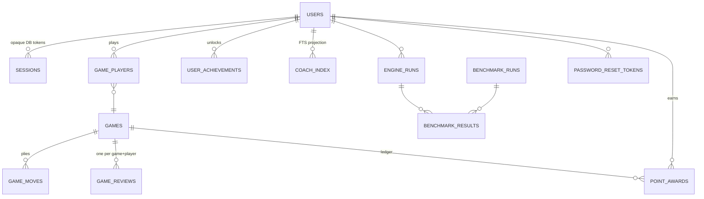

# Architecture

> Modular monolith. One deployable FastAPI app, one PostgreSQL database, one React frontend. Each domain has a single responsibility.

## System overview

```
React + TypeScript (web)
   Pages · Board · Game state · API client
              │  HTTP /api/v1
FastAPI application (api)
   REST API · validation · authentication · authorization
              │
   ┌──────────┼────────────┬────────────┬──────────────┐
   ▼          ▼            ▼            ▼              ▼
 Game domain  Engine domain  Identity    History/Stats  Benchmark
 rules,turns, our AI,       users,       saved games,    suites,
 status,      Stockfish     sessions,    statistics      metrics
 move history adapter       credentials
              └─────────────┴────────────┴──────────────┘
                              │
                         PostgreSQL
           transactions · migrations · indexes · constraints
```

## Data model (ER)



## Module responsibilities

| Module | Owns | Must NOT own |
|--------|------|--------------|
| `game` | Legal moves, turns, results, FEN, PGN | AI strategy or HTTP handling |
| `engine` | Move search and evaluation | User accounts or DB access |
| `identity` | Password hashing, sessions, authorization | Chess rules |
| `history` | Saving/retrieving games | Engine search |
| `benchmark` | Position suites, comparisons, metrics | Normal game state |
| `analysis` | Stored evals, win%, graphs, jobs (consumes engine results) | Search algorithms or invented evals |
| `reviews` (`app/reviews`) | Post-game pass: replay stored plies → MultiPV analysis → per-move grade + coaching sentence → stored JSON payload | Search; re-analysing on a read |
| `classification` | Move labels from structured analysis only (`app/engine/classifier.py`) | Guessing without engine proof fields |
| `coaching` | Grounded explanations citing stored fields (`app/reviews/explainer.py`) | Inventing evals/variations |
| `ai` (`app/ai`) | Engine-grounded Coach Assistant (Phase 11): long-context over the stored review + bounded what-if engine pass (`longcontext/`), Postgres-FTS cross-game recall over a `coach_index` projection + the offline book (`rag/`), deterministic composer with an optional env-gated LLM behind the cite-only grounding guard (`compose.py`, `provider.py`, `service.py`) | Naming any move it cannot cite from stored facts; making the LLM load-bearing (no key ⇒ deterministic path answers); a new vector/embedding dependency (deferred, see D13) |
| `openings` (`app/openings`) | Offline theory lookup: position → ECO + name (`app/openings/book.py` over the committed `book_data.py`) | Network fetches; claiming a name for a position the book does not hold |
| `achievements` (`app/achievements`) | Code-defined catalog, stat aggregation from stored rows, per-player unlock records | Any client-supplied counting |
| `tactics` | Pattern detectors over python-chess positions | Engine search or LLM judgement |
| `training` (`app/training`) | Drill catalog — hand-written core (`drills.py`) + a parametric, template-built bulk (`generate.py`), including a `sequence` theme of multi-move forced-line puzzles whose lines are certified at generation time — with a soundness proof for every position (`verify.py`), puzzles mined from stored reviews (`from_reviews.py`), append-only attempt log driving the ramp/progress/points and the stateless exact-line sequence grading (`service.py`) | Deciding the outcome in the browser; shipping a puzzle's answer in its payload; running an engine/search at grade time |
| `api` | HTTP schemas, status codes, request handling | Core chess algorithms |
| `web` | User interactions and visual state | Trusted game outcomes |

## Key boundaries

- The **API** never contains chess-search algorithms.
- The **custom engine** never does HTTP or database queries.
- The **analysis/classification/tactics/coaching** modules never invent chess facts:
  they consume stored engine output (evals, PVs, patterns) and cite it.
- The **frontend** never determines authoritative outcomes or validates AI moves.
  Sound, haptics and celebration animations are display-only layers: they read
  the server's events and never influence a game (`lib/game-events.ts`,
  `app/AchievementContext.tsx`).
- **Achievement stats** are aggregated from stored game/move/point/review rows;
  the catalog itself is code, so adding a milestone never needs a migration.
- A **review** is computed once per (game, player) and served from storage;
  reads never touch the engine, and the play path keeps the tight resource
  bounds while review uses the wider `REVIEW_MAX_*` envelope.
- Opening names and win expectancy are **derived on read** (`app/reviews/annotate.py`)
  from data the payload already holds. That is presentation, not re-analysis: the
  stored JSON is never rewritten, so adding a derived field needs no migration and
  no engine pass, and the cached `GET` and the fresh `POST` cannot drift.
- The spoken review narration (`lib/voice.ts`, `lib/narration.ts`) is a display
  layer over the same server fields — it never computes a chess fact, and it is
  inert where no speech engine exists.
- Use **dependency injection** to provide engines and repositories to services.
- Versioned API under `/api/v1`; all contracts explicit, validated, documented.

## Rules & engine split

- `python-chess` supplies legal move generation and position management.
- Our AI supplies evaluation and search only.
- Never write a second, independent rules engine.

## Proposed repository layout

```
apps/web/       React + TypeScript + Vite
apps/api/       FastAPI app, migrations, tests
docs/           architecture, plan, loops, agents, standards, decisions
infra/          Docker, deployment artifacts
scripts/        maintenance/utility scripts
.github/        CI workflows
compose.yaml    local Docker Compose
```

> This is a logical structure, not a requirement to create every folder on day one. Modules are added as functionality lands. Deviations are documented here.

## Decisions log

| # | Decision | Status | Note |
|---|----------|--------|------|
| D1 | Use python-chess for rules; own search algorithm | Accepted | No duplicate rules engine |
| D2 | Authenticated games saved to PostgreSQL from the first playable version | Accepted | "Local two-player" = who plays, not where state lives |
| D3 | Stockfish isolated behind the engine interface, bounded execution | Accepted | Licensing reviewed before distribution |
| D4 | npm as JS package manager (pnpm not installed) | Pending | Revisit if pnpm is added |
| D5 | Docker Compose for local dev; document local-Postgres fallback (Docker not installed) | Pending | FND-018/019 |
| D6 | Online human-vs-human play extends the modular monolith: Postgres stays authoritative; lobby queue, socket hub and rate-limiter are in-process state islands | Accepted | Single-replica assumption (online-plan §2): restarts drop queues/sockets but never games; scale-out requires moving ephemeral state to Redis/a broker — tracked as debt |
| D7 | Computer games are answered by Stockfish through `app/engine/opponent.py`, not the custom minimax | Accepted | Difficulty maps client depth (1..6) onto bounded Stockfish depth. `app/engine/factory.py` is the single decision seam (local binary → `StockfishProvider`, else hosted `CloudStockfishProvider` when `STOCKFISH_API_KEY` is set) shared by play and review. An unreachable engine is `503`, never a silent fallback to a weaker opponent |
| D8 | Achievement catalog in code, unlocks in one small table | Accepted | 200+ entries need no per-entry rows or migrations; unlocks ride mutation responses and are acknowledged once (`seen_at`) |
| D9 | Game review runs synchronously and stores its payload | Accepted (debt) | Simple and cached per (game, player), but it holds a worker for up to `REVIEW_MAX_TIME_MS`; job queue + eval cache remain Phase 9 items (ANL-005/008) |
| D10 | Opening theory is an offline, committed extract of `lichess-org/chess-openings` (CC0), shipped as a generated Python module and resolved at read time | Accepted | Server-side keeps one source of truth instead of a book in the browser bundle; a module (not a data file) survives `pip install .`, which only packages `app*`. `scripts/gen_opening_book.py` is the only thing that ever touches the network, so runtime and CI stay offline |
| D11 | `win_pct` is an **engine win expectancy** from the evaluation, never a population result rate | Accepted | Logistic on the eval's Elo equivalent (1 pawn ≈ 200 Elo ⇒ 76%), mate distance overriding; no third-party stats, so no dependency on an external host being reachable (ANL-004) |
| D12 | Training drills are built from templates and re-proved by python-chess at test time; the server is the only place a solution is known | Accepted | Teaching needs a `why` sentence per theme, so the core set is hand-written; the bulk (`generate.py`) grows it by constructing each idea from a geometric template and keeping only what `verify.verify()` proves sound — a candidate that drifts from its theme is dropped, never shipped. Every position (curated or generated) is re-verified deterministically (`verify.py`, `verify_all()` in CI), so an unsound drill fails the build rather than teaching nonsense. `GET /training/puzzle` is deliberately answer-free and the verdict is computed server-side, honouring the rule that the frontend never determines outcomes. Multi-move puzzles are in scope through the `sequence` theme: the whole forced line is enumerated **only at generation time** (an offline authoring pass embeds certified seeds that `verify()` re-proves at import), and grading is a deterministic **exact-line replay** — the opponent's every reply has a single legal move, so no engine or search runs at grade time. The accepted one-move-per-puzzle limit (TD-019) governs single-move drills and now applies per ply to sequences (a co-existing alternative move is marked wrong) |
| D13 | The ⭐ Coach Assistant grounds every answer in engine + book facts via **long-context over the stored review** (this game: positions, best way to proceed, bounded live MultiPV what-ifs) plus **Postgres full-text RAG** over a `coach_index` projection and the offline book (across games: recurring errors, opening theory) — **no pgvector/embeddings**; an OpenAI-compatible LLM is optional, env-gated, and only ever *rephrases* cited facts behind a cite-only guard that falls back to the deterministic answer | Accepted | FTS + the existing book answer the two recall needs with zero new dependency, keeping the offline/CI guarantee and one Postgres source of truth; embeddings/pgvector is a deferred growth path (TECHNICAL_DEBT) that would only add paraphrase robustness, not new facts. The guard is what makes an LLM safe here: a reply naming a move absent from the cited facts is discarded, so the model can phrase but never invent (`compose.py::grounded`, `service.py`). **Phase 11b** extends the same guarantee: the composer now emits multi-section teaching (recommendation / idea / line / why-it-is-better) plus a grounded **walkable variation** materialised from a live engine PV or, offline, the recorded plies (`longcontext/lines.py`) that the coach drives across the **main review board**, and follow-ups like "and after that?" resolve against a bounded **conversation memory** with focus carry-forward — so every move the board ever shows still traces to a stored ply or a fresh engine line, with no new dependency and no schema migration (lines are computed on read) |
| D14 | Observability = Prometheus `/metrics` (instrumentator) + JSON-line logs with `request_id`; no self-hosted monitoring stack | Accepted (Phase 12A) | Per-route RED for free; bespoke instruments only for what actually hurts: engine latency/availability by provider, limiter rejections, the shared cloud-engine daily budget, active WS connections. The host scrapes `/metrics`; alert targets live in `docs/deployment.md` §8. Sentry/OTel stay a config-time decision behind the `main.py` seam |
| D15 | Rate limiting keeps the function seams (`check_*` by cost, not just by count) and swaps backends on a trigger, not a schedule | Accepted (Phase 12A) | In-memory sliding windows are honest for the single-replica assumption (D6/TD-012); the Redis swap happens when a second replica lands, behind identical signatures so routers never change. New surfaces get buckets by expense: a review holds a warm engine ~12 s (10/hour/user, `force` costs 2), a training attempt writes ledger rows, and the hosted engine's 2,000-units/day is an **app-wide pot** — the guard trips at ~1,800 with a clean 503 *before* upstream rejects. Every 429 carries `Retry-After` |
| D16 | Privileged access = one `users.role` column (`player`/`moderator`/`admin`) + `require_role()` + `audit_log`; ownership authorization unchanged | Accepted (Phase 12B) | A roles/permissions join table is premature until a fourth role is genuinely requested (watched risk: overengineered abstractions). RBAC is a **staff overlay**, never a player-facing permission system — players keep seeing foreign resources as 404. Rule: any admin write without an audit row is a bug; the points ledger already gives the safe shape for adjustments (reason-only rows, never mutating `users.points`). Opaque DB session tokens keep the real kill switch (revoke on role change / support reset) |
| D17 | Anti-cheat is evidence-first: capture cheap and early, detect with signals, **flag only — never auto-punish**; moderation verdicts are the enforcement | Accepted (Phase 12C) | The false-positive cost is asymmetric: locking out a real player damages trust more than a cheat slipping through a week. Signals (engine-agreement via the provider seam on a bounded sweep, server-measured think-time profiles, salted-IP clustering) compose a score stored with its raw inputs, so thresholds can be re-tuned without recompute (TD-022). Privacy posture: salted SHA-256 of IPs with a 180-day retention, never raw logs; client-reported clocks are ignored entirely. Detection runs through the same D7/ANL-003 seams — no second engine path |

See `docs/decisions/` for full decision records as they arise.
